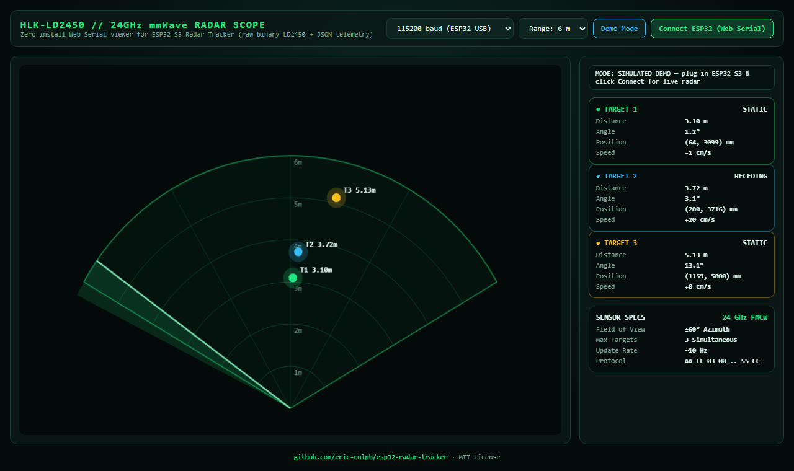
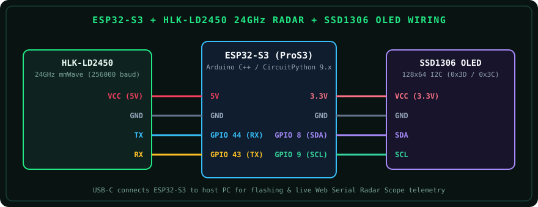

# ESP32 Radar Tracker (HLK-LD2450)

[](https://github.com/eric-rolph/esp32-radar-tracker/actions/workflows/ci.yml)
[](https://eric-rolph.github.io/esp32-radar-tracker/)
[](arduino/ESP32_Radar_Tracker.ino)
[](LICENSE)

Real-time **24 GHz mmWave radar motion tracker** for the **ESP32-S3**, **HLK-LD2450** multi-target radar sensor, and **SSD1306 128×64 OLED display** — with both **Arduino C++** and **CircuitPython 9.x** firmware plus a zero-install **Web Serial live radar scope**.

> **Try it in your browser:** [**Launch the Live Web Serial Radar Scope →**](https://eric-rolph.github.io/esp32-radar-tracker/)  
> Runs an interactive 3-target simulation out of the box, or click **Connect ESP32 (Web Serial)** in Chrome/Edge to plot live raw binary LD2450 frames or JSON telemetry from your board.

<p align="center">
  <a href="https://eric-rolph.github.io/esp32-radar-tracker/">
    
  </a>
</p>

---

## Wiring Diagram

<p align="center">
  
</p>

| Component | Pin | ESP32-S3 (ProS3) | Notes |
|---|---|---|---|
| **HLK-LD2450** | `VCC` / `GND` | `5V` / `GND` | 5 V regulated supply required |
| **HLK-LD2450** | `TX` / `RX` | `GPIO 44` (RX) / `GPIO 43` (TX) | UART @ **256000 baud** |
| **SSD1306 OLED** | `VCC` / `GND` | `3.3V` / `GND` | 128×64 monochrome I2C |
| **SSD1306 OLED** | `SDA` / `SCL` | `GPIO 8` / `GPIO 9` | Auto-detects `0x3D` or `0x3C` |

---

## Features

- **3-Target Simultaneous Tracking:** Proper HLK-LD2450 16-bit sign-magnitude decoding for X/Y coordinates, radial speed (cm/s), distance, and azimuth angle (±60°, up to 6 m), plus 500 ms stale-frame auto-clear.
- **Unified CircuitPython Firmware (`circuitpython/code.py`):** Switch between `alien`, `sweep`, `minimal`, and `diagnostic` display themes with one variable, auto-fallback OLED I2C detection (`0x3D` → `0x3C`), NeoPixel proximity indicator, and JSON USB telemetry streaming.
- **Optimized Arduino C++ Firmware (`arduino/`):** `HLK_LD2450.h` and `RadarDisplay.h` with PlatformIO support (`platformio.ini`).
- **Live Browser Radar Scope (`docs/index.html`):** Zero-install Web Serial viewer with phosphor target trails, range rings, and live distance/speed cards.
- **Automated Protocol Tests:** Both `arduino/HLK_LD2450.h` (C++17) and `circuitpython/ld2450.py` (Python) are unit-tested in GitHub Actions CI.

---

## Quick Start

### Option 1: CircuitPython 9.x (Fastest)
1. Install CircuitPython 9.x on your ESP32-S3 and copy `adafruit_ssd1306` (and optional `neopixel`) into `CIRCUITPY/lib/`.
2. Copy [`circuitpython/code.py`](circuitpython/code.py) and [`circuitpython/ld2450.py`](circuitpython/ld2450.py) to the root of your `CIRCUITPY` drive (or run `python utils/deploy_circuitpython.py`).
3. Edit `DISPLAY_MODE = "alien"` (`"alien"`, `"sweep"`, `"minimal"`, or `"diagnostic"`) at the top of `code.py`.

### Option 2: Arduino IDE / PlatformIO
1. Install **Adafruit SSD1306** and **Adafruit GFX Library** (or run `pio run -t upload` in `arduino/`).
2. Open [`arduino/ESP32_Radar_Tracker.ino`](arduino/ESP32_Radar_Tracker.ino), select **ESP32-S3 Dev Module**, and upload.

### Option 3: Live Web Serial Radar Scope
Open [**eric-rolph.github.io/esp32-radar-tracker**](https://eric-rolph.github.io/esp32-radar-tracker/) in Chrome or Edge, select `115200 baud (ESP32 USB)` (or `256000 baud` for a direct USB-UART adapter on the LD2450), and click **Connect ESP32 (Web Serial)**.

---

## Project Structure

```text
esp32-radar-tracker/
├── arduino/                  # Arduino C++ / PlatformIO firmware
│   ├── ESP32_Radar_Tracker.ino
│   ├── HLK_LD2450.h          # Sign-magnitude frame parser + 500ms stale timeout
│   ├── RadarDisplay.h        # 128x64 OLED graphics renderer
│   └── platformio.ini
├── circuitpython/
│   ├── code.py               # Unified tracker (alien / sweep / minimal / diagnostic)
│   ├── ld2450.py             # Reusable pure-Python HLK-LD2450 parser
│   ├── diagnostics/          # I2C scanner, raw byte & protocol debug tools
│   └── legacy/               # Earlier standalone display experiments & notes
├── docs/
│   ├── index.html            # Zero-install Web Serial Live Radar Scope (GitHub Pages)
│   └── wiring_diagram.svg    # Pinout & wiring graphic
├── tests/
│   ├── test_ld2450.cpp       # Native C++17 unit tests for HLK_LD2450.h
│   └── test_ld2450.py        # Pytest suite for circuitpython/ld2450.py
└── utils/                    # Cross-platform serial monitor & deploy utilities
```

---

## HLK-LD2450 Sensor Specs

| Parameter | Value |
|---|---|
| Operating Frequency | 24 GHz FMCW mmWave |
| Detection Range | 0 – 6 meters |
| Azimuth Field of View | ±60° |
| Max Simultaneous Targets | 3 |
| Serial Protocol | UART, **256000 baud**, 8N1 (`AA FF 03 00` … `55 CC`) |
| Refresh Rate | ~10 Hz |

## Running Tests Locally

```bash
# Python parser tests
pytest tests/test_ld2450.py -v

# C++ header tests
g++ -std=c++17 -I tests/mocks -I arduino tests/test_ld2450.cpp -o test_ld2450 && ./test_ld2450
```

## License

MIT License — see [LICENSE](LICENSE) and [NOTICE.md](NOTICE.md).
